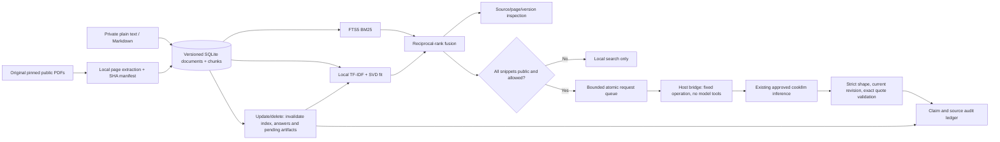

# Architecture

One application process uses fresh SQLite connections and an RLock around state/index operations. Source identities include original bytes plus prepared page content and metadata; a corrected extraction changes the indexed version even if PDF bytes stay the same. Deterministic chunk IDs include document/version/page/position. Only changed documents replace chunks. A corpus revision invalidates all dependent answer content conservatively. Latent vectors are fitted in memory and rebuilt after changes so deleted terms do not remain in a saved basis. The model is intentionally bounded to 1,000 chunks/10,000 features, not a distributed vector service.

The answer queue persists its row and attempt count before publishing a mode-0600 request by atomic rename. Committed orphan requests fail on initialization without replay or refund. Requests expire after360seconds. Terminal artifact cleanup follows DB commit, preventing a rollback from destroying a still-valid request/result. The host bridge owns a separate fsynced call ledger under data/bridge-control, outside app mounts. A host crash after a recorded attempt cannot cause automatic model replay. Only known UUID request/response files are used; symlinks, oversized/malformed/nonfinite files and stale or forged citations fail closed.

The host controller checks every proposed excerpt against a page in a pinned public original, not just an app-provided public flag. Restore may increment the indexed version while preserving the allowed original content. The fixed tool-free generation operation uses the existing claude-omni launcher, safe minimal runtime customizations, cookllm, an empty MCP config, one turn, bounded output/time and no session persistence. It cannot run source-supplied instructions as tools. The app has no execution API, model credentials, host config or Docker socket. This is a scoped local control boundary, not a claim of provider retention guarantees or enterprise sandboxing.

Every accepted claim has one or more exact quote supports from its supplied snapshot and current indexed version. Corpus changes cancel pending and cached content; a late file is removed rather than resurrected. Quote membership establishes source provenance, not semantic truth. Human evaluation separately checks entailment and abstention. Underlying model weights behind cookllm are not pinned/exposed by this app, so live outputs can vary.

All HTTP routes validate loopback Host and use local CSP/no-store headers; browser mutations require same-origin, and a512KiB body cap applies before JSON parsing. UI renders text with DOM textContent and allowlists original PDF links. Runtime reads prepared sources read-only, stores independent app state in its named volume, and binds only127.0.0.1:8283. Acquisition, evaluation, bridge control and static source stay on the host. Imported confidential material is not needed for this demonstration.
